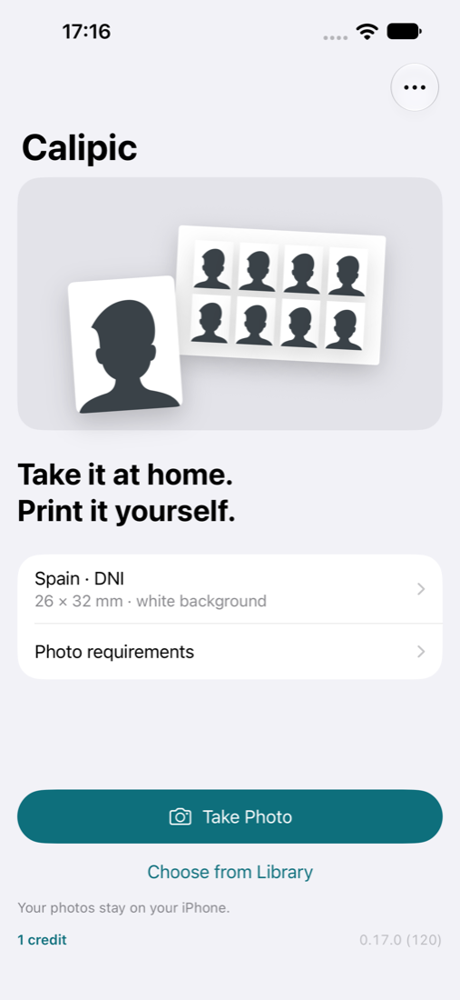
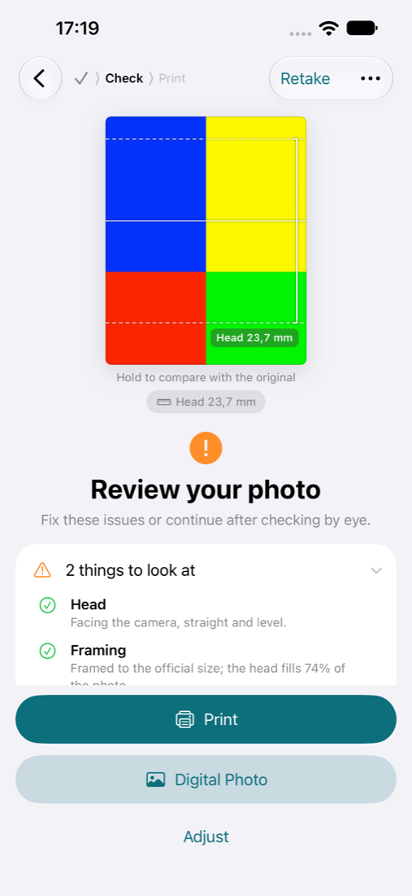
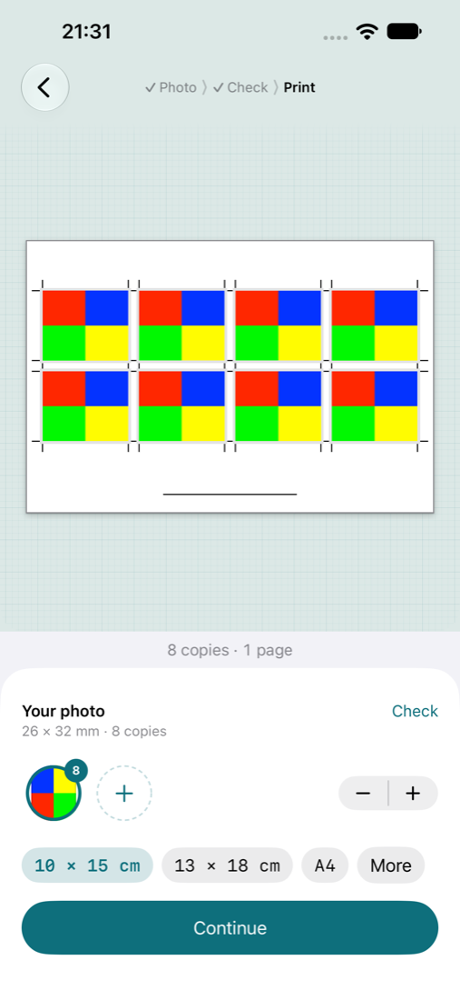
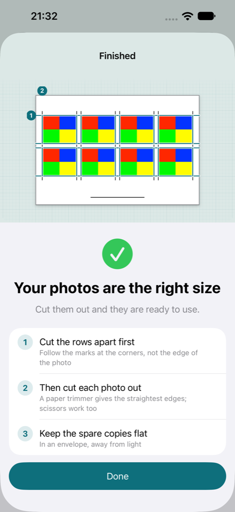

# Calipic

A native iPhone app for making ID photos at home and printing them yourself.

Take the photo with a guided camera, let the app frame it to the document's rules, replace the background, even the light, lay out copies on real paper, and print at the exact size. Everything happens on the iPhone: no account, no upload, no ads.

**Status (2026-11-12):** version 0.16.0. The whole journey works on an iPhone for 22 official documents and custom sizes, in English, Spanish, and Portuguese (Brazil). Purchases, saved drafts, and device evidence are not done yet.

   

## Start here

| Document | What it tells you |
|---|---|
| [docs/00-handoff.md](docs/00-handoff.md) | Current state, how to build and test, how the founder works, what to do first |
| [docs/01-product.md](docs/01-product.md) | The product, pricing, the journey, how "best" is measured |
| [docs/02-roadmap.md](docs/02-roadmap.md) | The plan to App Store 1.0 and the next batches of work |
| [docs/03-design.md](docs/03-design.md) | How the app looks and behaves today, and the design direction |
| [docs/04-architecture.md](docs/04-architecture.md) | Code map, the life of a photo, rules, credits, tests |
| [docs/05-decisions.md](docs/05-decisions.md) | Decisions in force and the open ones |
| [docs/06-markets-and-documents.md](docs/06-markets-and-documents.md) | Countries, documents, how to add a profile |
| [AGENTS.md](AGENTS.md) | The engineering rules every contributor follows |

## Run it

Open [`Calipic/Calipic.xcodeproj`](Calipic/Calipic.xcodeproj) in Xcode 27 and run the `Calipic` scheme on an iPhone or a simulator (iOS 27 or later). The simulator has no camera; use **Choose from Library** there.

```sh
export DEVELOPER_DIR=/Applications/Xcode.app/Contents/Developer
xcrun simctl list devices available
scripts/test.sh auto        # all tests on an iOS 27 iPhone simulator
```

More commands are in the [handoff](docs/00-handoff.md).

## Layout

```text
Calipic/               the app, its tests, and UI tests
Rules/catalog/v1/      document rules as versioned data, with sources
scripts/               version bump, tests, rules validator, wording check, icon generators, country ranking
docs/                  the seven documents above, profile research, design rounds, screenshots
```

## Principles

- **The person is the content.** The photo is the main thing on every screen.
- **Precision must be real.** The app says what it measured and what the person must check by eye. *Ready* never means accepted: the office that receives the photo decides.
- **Rules are data.** Every official profile has sources and a review date. Unknown requirements stay unknown.
- **Private by behaviour.** Photos stay on the iPhone.
- **Native first.** Apple frameworks and system controls; no third-party dependencies.
- **Fair price.** One free credit, then one credit per photo. No subscription.
