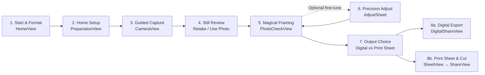

# Repository & Documentation Review: Becoming the #1 Home ID-Photo & Self-Print App

> **Review record (2026-11-11).** Kept as written. The founder's decisions taken after this review (ADR-017, ADR-020, ADR-047 to ADR-050) override it where they differ, and [the product blueprint §10](20-product-blueprint.md) lists which of its points were adopted.

To become the **#1 app for taking document photos at home and printing them yourself**, **Calipic** must win on four pillars:
1. **Effortless capture quality at home** (real-time physical guidance + reversible on-device Vision/Core Image processing).
2. **True-scale self-printing** (millimetre-exact sheets, family/multi-size packing, AirPrint & retail 4×6 lab compatibility, and physical verification).
3. **Purposeful "wow" moments** (earned satisfaction at capture, background preparation, and sheet layout—without gimmicky "AI theater").
4. **Quietly premium iOS craft** (calm, native SwiftUI hierarchy that makes a bureaucratic chore feel effortless).

---

## 1. Audit of Current Repository vs. Documentation

### A. Where the Codebase Is Ahead of the Top-Level Docs
The native iOS spike (`v0.12.7` in [Spikes/IDPhotoSpike](../Spikes/IDPhotoSpike/README.md#L1-L40)) is already a working end-to-end product prototype, but top-level docs describe an early skeleton:
- [README.md](../README.md#L11-L26) still states the prototype only supports *"photo import, a 26 × 32 mm portrait crop, JPEG sharing, and an A6 PDF with six copies"*.
- [docs/06-delivery-plan.md](06-delivery-plan.md#L249-L266) still lists *"Create the M1 native iOS spike Xcode project"* as the next step.
- In reality, [`PhotoWorkflow`](../Spikes/IDPhotoSpike/App/Features/PhotoWorkflow.swift#L162-L265) and [`AppFlowView`](../Spikes/IDPhotoSpike/App/Features/AppFlow.swift#L42-L120) already implement:
  - **Guided live camera** ([`CameraView`](../Spikes/IDPhotoSpike/App/Camera/CameraView.swift#L8-L90), [`CameraFramingGuide`](../Spikes/IDPhotoSpike/App/Camera/CameraFramingGuide.swift#L1-L120)) with one head oval, edge-connected phone-movement arrows, live Vision/metadata pose & lighting checks, optional `Auto` 3–2–1 countdown, and immediate still review (`Retake` / `Use Photo`).
  - **Automatic image preparation** via Vision face/crown geometry ([`FaceAnalyzer`](../Spikes/IDPhotoSpike/App/Vision/FaceAnalyzer.swift#L1-L90), [`FaceGeometry`](../Spikes/IDPhotoSpike/App/Domain/FaceGeometry.swift#L1-L120)), person segmentation onto a pure white background ([`BackgroundSegmenter`](../Spikes/IDPhotoSpike/App/Image/BackgroundSegmenter.swift#L1-L95)), and reversible [`ToneAdjuster`](../Spikes/IDPhotoSpike/App/Image/ToneAdjuster.swift#L1-L120) (`Document Tone`).
  - **Photo Check & Adjust** ([`PhotoCheckView`](../Spikes/IDPhotoSpike/App/Features/PhotoCheckView.swift#L6-L95), [`AdjustSheet`](../Spikes/IDPhotoSpike/App/Features/AdjustSheet.swift#L1-L140)) with a 600 ms source-to-framed landing animation, hold-to-compare `Original`, `Original`/`White` background toggle, and accessible `Move`/`Zoom` controls.
  - **Multi-person, multi-size print sheet composer** ([`SheetView`](../Spikes/IDPhotoSpike/App/Features/SheetView.swift#L6-L150)) supporting up to 6 people, multiple copy sizes per person, a 2D guillotine layout solver, adaptive 0–1 mm bleed, corner cut ticks, and a 50 mm scale check bar.

### B. Contradictions & Superseded Specs Across `docs/`
1. **Superseded UX/Camera Research Docs**:
   - [docs/15-experience-plan.md](15-experience-plan.md#L1-L120) specifies a shutter progress ring, a mandatory 2-page camera intro, and sheet-only export—all superseded by [ADR-043](10-decisions.md#L1185-L1233) and [ADR-044](10-decisions.md#L1235-L1285).
   - [docs/18-camera-selfie-experience-research.md](18-camera-selfie-experience-research.md#L1-L120) and [docs/19-capture-wow-moment-research.md](19-capture-wow-moment-research.md#L1-L140) recommend custom acoustic earcons, double-transient CoreHaptics, subject-contour shimmer sweeps, and biometric compliance medallions on the camera freeze frame—which were **explicitly rejected** by [ADR-045](10-decisions.md#L1287-L1338) and [ADR-046](10-decisions.md#L1340-L1395) in favor of native restraint.
2. **Launch Market vs. Initial Format Mismatch**:
   - [ADR-016](10-decisions.md#L334-L361) locks Spain `foto carnet` (`26 × 32 mm`) as the single initial format, while [BD-032](brand/99-brand-decisions-log.md#L395-L407) prioritizes the **United States** commercially and [BD-031](brand/99-brand-decisions-log.md#L381-L393) ships **English, Spanish, and Brazilian Portuguese** (`en`, `es`, `pt-BR`). Launching in the US, Spain, and Brazil requires US (`2 × 2 in` / `51 × 51 mm`), Spain (`26 × 32 mm`), EU/ICAO (`35 × 45 mm`), and Brazil (`3 × 4 cm` / `30 × 40 mm`) in the 1.0 profile catalog.
3. **Monetization Decision Drift**:
   - [ADR-015](10-decisions.md#L309-L332) still marks monetization as *Deferred*, whereas [BD-029](brand/01-brand-foundations.md#L352-L368) locked a **credit model** (first result free + 1 initial free credit, low-cost credit packs, no subscriptions, no ads). Neither [docs/02-requirements.md](02-requirements.md#L186-L195) nor [docs/16-screen-experience-spec.md](16-screen-experience-spec.md#L1-L90) specifies the credit rules or StoreKit 2 UI.
4. **Design Priority vs. Accessibility**:
   - [docs/brand/01-brand-foundations.md](brand/01-brand-foundations.md#L218-L227) ranks `1. Native iOS familiarity, 2. Beauty, 3. Accessibility`, conflicting with [AGENTS.md](../AGENTS.md#L79-L85), [ADR-030](10-decisions.md#L761-L785), and [docs/brand/02-experience-constitution.md](brand/02-experience-constitution.md#L140-L154) where accessibility is a non-negotiable baseline alongside native familiarity and beauty.

### C. Product Gaps Against the "#1 Home Capture & Self-Print" Goal
1. **Home-Studio Setup & Rear-Camera Helper Guidance**: Taking a great photo at home fails most often due to wall shadows (standing too close to the wall) or uneven side lighting. Preflight ([`PreparationView`](../Spikes/IDPhotoSpike/App/Features/PreparationView.swift#L1-L95)) needs concrete home-positioning coaching (*"Face a window or bright light, stand 0.5–1 m ahead of a plain wall"*), and Guided Camera needs explicit rear-camera helper cues when a family member takes the photo.
2. **Last-Mile Home Printing, Physical Verification & Cutting**: [`ShareView`](../Spikes/IDPhotoSpike/App/Features/ShareView.swift#L6-L120) stops at *"Your files are ready"*. Because printer auto-scaling (`Fit to Page`) is the #1 source of 1-star reviews in ID photo apps ([docs/14-priority-feature-plan.md](14-priority-feature-plan.md#L118-L131)), the flow must include an interactive **50 mm physical ruler check**, printer scaling recovery (*"Measured 48 mm? Disable Fit to Page"*), **4×6 retail photo-lab instructions** (printing the 300 ppi JPEG at a pharmacy/kiosk when the user has no colour printer at home), and **cutting guidance** using the outer corner ticks.

---

## 2. Target Documentation Blueprint

Below is the complete product specification that the repository documentation should codify across functions, screens, user journey, "wow" moments, and launch roadmap.

### A. Complete Customer & User Journey (8 Stages)

| Stage | User Goal | App Assistance & Image Processing | Satisfaction / "Wow" Moment |
| :--- | :--- | :--- | :--- |
| **1. Start & Format Selection** ([`HomeView`](../Spikes/IDPhotoSpike/App/Features/HomeView.swift#L6-L130)) | Pick the right document format (or resume default) and choose `Take Photo` or `Choose from Library`. | Remembers active country/profile; shows exact millimetre dimensions (`26 × 32 mm`) and real portrait preview immediately. | **Zero-friction entry**: No account wall, no ad banner, no quiz—just a quiet, tactile studio card ready in 1 tap. |
| **2. Home Setup ("Before your photo")** ([`PreparationView`](../Spikes/IDPhotoSpike/App/Features/PreparationView.swift#L6-L95)) | Position yourself at home for a shadow-free, well-lit portrait. | 3 scannable home rules: (1) Plain wall (`0.5–1 m` behind subject to avoid shadows), (2) Even front lighting (face a window/lamp), (3) Neutral expression & clear eyes. | **Confidence before the camera opens**: The user knows *how* to stand in their living room before seeing the live preview. |
| **3. Guided Capture** ([`CameraView`](../Spikes/IDPhotoSpike/App/Camera/CameraView.swift#L8-L180)) | Align head & shoulders and capture at peak steadiness (solo front camera or helper rear camera). | 15–30 fps Vision face landmarks + yaw/pitch/roll + exposure check ([`CameraPreviewAnalysing`](../Spikes/IDPhotoSpike/App/Camera/CameraController.swift#L15-L90)). Single priority status pill + edge-connected directional arrows ([`CameraFramingGuide`](../Spikes/IDPhotoSpike/App/Camera/CameraFramingGuide.swift#L1-L120)). Optional `Auto` 3–2–1 shutter when ready for 650 ms. | **The Alignment Lock**: The oval smoothly turns green (`#34C759`), directional arrows fade out, and a crisp selection haptic confirms *"Ready — take photo"*. |
| **4. Capture Climax & Still Review** ([`CameraView`](../Spikes/IDPhotoSpike/App/Camera/CameraView.swift#L95-L175)) | Verify eyes are open and expression is natural on the exact captured photo. | Native shutter sound + single soft white bloom (peak opacity `0.28`, `180 ms` fade) + frozen captured still inside the dimmed 26×32 mm aperture with `Retake` and `Use Photo` ([ADR-045](10-decisions.md#L1287-L1338)). | **No blind jump**: Unlike apps that yank the user into a loading spinner, the user sees their actual frozen portrait inside the frame and chooses `Use Photo` with certainty. |
| **5. Magical Framing & Photo Check** ([`PhotoCheckView`](../Spikes/IDPhotoSpike/App/Features/PhotoCheckView.swift#L6-L180)) | Confirm that the prepared ID photo looks natural and meets official rules. | Full-res Vision face/crown geometry solver ([`FaceGeometry`](../Spikes/IDPhotoSpike/App/Domain/FaceGeometry.swift#L1-L120)), person segmentation onto pure `#FFFFFF` ([`BackgroundSegmenter`](../Spikes/IDPhotoSpike/App/Image/BackgroundSegmenter.swift#L1-L95)), reversible `Document Tone` ([`ToneAdjuster`](../Spikes/IDPhotoSpike/App/Image/ToneAdjuster.swift#L1-L120)), and plain-language compliance checks. | **The Transformation Landing ("Hero Wow")**: Over 600 ms (`.spring(response: 0.55, dampingFraction: 0.86)`), the casual room photo settles into a studio-grade, white-background ID portrait with a green `Ready to use` badge and press-and-hold `Original` comparison. |
| **6. Precision Adjust (Optional)** ([`AdjustSheet`](../Spikes/IDPhotoSpike/App/Features/AdjustSheet.swift#L6-L160)) | Nudge crop, toggle `Original`/`White` background, or fine-tune light/colour. | Direct pan/pinch + accessible `Move`/`Zoom` steppers + rotation slider + `Original`/`White` background switch + `Light & colour` (`Document Tone` + 7 sliders) + `Details` (`Sharpness`, `Noise Reduction`). | **Effortless studio control**: Holding `Original` or toggling `White` updates the portrait live without destructive re-crops. |
| **7. Output Choice** ([`OutputChoiceView`](../Spikes/IDPhotoSpike/App/Features/OutputChoiceView.swift#L6-L95)) | Choose between a single digital file (online renewal) or a physical print sheet. | Presents two calm cards: `Digital Photo` (`520 × 640 px` JPEG) and `Print Sheet` (multi-copy PDF, 300 ppi JPEG, AirPrint). | **Clarity of intent**: Users who only need an online upload finish in one tap; home printers proceed directly to sheet layout. |
| **8. Multi-Copy Sheet, Print, Verify & Cut** ([`SheetView`](../Spikes/IDPhotoSpike/App/Features/SheetView.swift#L6-L150), [`ShareView`](../Spikes/IDPhotoSpike/App/Features/ShareView.swift#L6-L140)) | Pack photos for 1–6 people (and extra sizes like wallet/visa), print at 100% scale, verify with a ruler, and cut cleanly. | Guillotine 2D bin-packing ([`SheetLayoutCalculations`](../Spikes/IDPhotoSpike/App/Print/SheetComposer.swift#L1-L180)), adaptive 0–1 mm cutting bleed, outer corner cut ticks, 50 mm scale bar, AirPrint `.photo` with bordered paper preference ([`PrintController`](../Spikes/IDPhotoSpike/App/Print/PrintController.swift#L1-L110)). | **The Self-Print Payoff**: Watching the sheet spring-animate as you add family members or a second size—then measuring the printed `50 mm` bar at home and seeing it match a physical ruler to the millimetre. |

---

### B. Complete Catalog of App Functions & Functionalities

| Domain | Function / Capability | Current Spike (`v0.12.7`) Status | 1.0 Launch Target |
| :--- | :--- | :--- | :--- |
| **1. Country & Document Rules Engine** | Versioned JSON catalog of country/document profiles (dimensions, head-height ratio, eye-line band, background colour, DPI/px output) | Single Spain `foto carnet` profile (`26 × 32 mm`) + custom sheet sizes | Searchable multi-country catalog (`ES` 26×32 mm, `US` 2×2 in, `EU/ICAO` 35×45 mm, `BR` 3×4 cm, `UK`, `CA`) with effective dates & official source links ([docs/05-rules-engine.md](05-rules-engine.md#L1-L120)) |
| **2. Guided Camera & Home Capture Assistance** | Front/back camera session, real-time Vision face pose/size/centering + luma evaluation, single oval + edge arrows, voice guidance (`AVSpeechSynthesizer`), `Auto` 3–2–1 capture, still review (`Retake`/`Use Photo`) | Implemented in [`CameraController`](../Spikes/IDPhotoSpike/App/Camera/CameraController.swift#L1-L120) & [`CameraView`](../Spikes/IDPhotoSpike/App/Camera/CameraView.swift#L1-L180) | Add home-setup coaching (wall distance & window lighting) + dedicated rear-camera helper distance prompts |
| **3. Photo Library Import** | Native `PhotosPicker` import with EXIF orientation normalization and full suitability validation | Implemented in [`AppFlowView`](../Spikes/IDPhotoSpike/App/Features/AppFlow.swift#L60-L115) & [`PhotoWorkflow`](../Spikes/IDPhotoSpike/App/Features/PhotoWorkflow.swift#L180-L245) | Keep zero-permission `PhotosPicker` flow + pre-import low-resolution warning |
| **4. Biometric Geometry & Auto-Framing** | Vision face rectangle + landmark detection, crown estimation, roll straightening, and deterministic millimeter-to-pixel crop solver | Implemented in [`FaceAnalyzer`](../Spikes/IDPhotoSpike/App/Vision/FaceAnalyzer.swift#L1-L90) & [`FaceGeometry`](../Spikes/IDPhotoSpike/App/Domain/FaceGeometry.swift#L1-L120) | Calibrate across multi-profile target bands (US 2×2 in vs ICAO 35×45 mm vs Spain 26×32 mm) |
| **5. Background Segmentation & Replacement** | On-device person instance mask (`VNGenerateForegroundInstanceMaskRequest`), hair-edge feathering, pure white `#FFFFFF` studio background, automatic fallback if confidence is low | Implemented in [`BackgroundSegmenter`](../Spikes/IDPhotoSpike/App/Image/BackgroundSegmenter.swift#L1-L95) | Add profile-specific background target colours (e.g. off-white/light grey where required) + optional iOS 27 `VNGenerateInteractiveInstanceMaskRequest` touch-up ([ADR-041](10-decisions.md#L1060-L1148)) |
| **6. Reversible Tone & Image Processing** | `Document Tone` preset (exposure, shadows, contrast, neutral skin warmth, vibrance, sharpening) + manual `Light & colour` and `Details` sliders + hold-to-compare `Original` | Implemented in [`ToneAdjuster`](../Spikes/IDPhotoSpike/App/Image/ToneAdjuster.swift#L1-L120) & [`AdjustSheet`](../Spikes/IDPhotoSpike/App/Features/AdjustSheet.swift#L1-L160) | Strict identity-preservation guardrails (never alter facial structure, moles, or scars) |
| **7. Plain-Language Compliance Verification** | Evaluates framing, head height, eye line, head tilt/turn, resolution, and background uniformity; outputs `Ready to use`, `Check before printing`, or `Retake recommended` | Implemented in [`PhotoCheckView`](../Spikes/IDPhotoSpike/App/Features/PhotoCheckView.swift#L1-L180) & [`PhotoWorkflow`](../Spikes/IDPhotoSpike/App/Features/PhotoWorkflow.swift#L320-L420) | Add shadow/lighting asymmetry detector and glasses-glare advisory |
| **8. Multi-Person & Multi-Size Print Sheet Composer** | Up to 6 people (`Person A–F`), multiple photo sizes per person, paper presets (`10×15 cm / 4×6 in`, `A6`, `13×18 cm / 5×7 in`, `A4`, `Letter`, `Custom mm`), guillotine packing, 0–1 mm adaptive bleed, corner cut ticks, `50 mm` check bar | Implemented in [`SheetView`](../Spikes/IDPhotoSpike/App/Features/SheetView.swift#L1-L150) & [`SheetComposer`](../Spikes/IDPhotoSpike/App/Print/SheetComposer.swift#L1-L180) | Add quick preset templates (*"Single person – 8 copies"*, *"Family pack"*, *"ID + Wallet combo"*) |
| **9. Export, AirPrint & Physical Size Verification** | Verified single JPEG (`520×640 px`), vector/300 ppi PDF, 300 ppi page JPEGs, AirPrint with `.photo` and bordered paper selection | Implemented in [`ShareView`](../Spikes/IDPhotoSpike/App/Features/ShareView.swift#L1-L140) & [`PrintController`](../Spikes/IDPhotoSpike/App/Print/PrintController.swift#L1-L110) | Add interactive **Post-Print 50 mm Verification & Cutting Guide** + **4×6 Retail Photo Lab** instructions |
| **10. Fair Monetization (Credits)** | First completed result free + 1 initial free credit, low-cost StoreKit 2 credit packs, no subscriptions, no ads ([BD-029](brand/01-brand-foundations.md#L352-L368)) | Not yet in spike | Implement StoreKit 2 credit ledger, upfront credit badge, and restore/help flows |

---

### C. Complete Screen Inventory (Current Spike vs. 1.0 Launch)

| # | Screen / Surface | Implementation File | Primary Role & Single Primary CTA | Status |
| :--- | :--- | :--- | :--- | :--- |
| **1** | **Home (`Calipic`)** | [`HomeView.swift`](../Spikes/IDPhotoSpike/App/Features/HomeView.swift) | Active format card (`26 × 32 mm`), sample portrait, primary `Take Photo`, secondary `Choose from Library`, inline `Requirements`. | Built (`v0.12.7`) |
| **2** | **Document & Country Picker** | *New (`ProfilePickerSheet.swift`)* | Search/select country & document profile (`ES`, `US`, `EU`, `BR`, etc.) from Home format badge. | **Add for 1.0** |
| **3** | **Before Your Photo (Preflight)** | [`PreparationView.swift`](../Spikes/IDPhotoSpike/App/Features/PreparationView.swift) | 3 short home-setup rules (plain wall distance, even front light, neutral pose) + `Open Camera`. | Built (enrich copy) |
| **4** | **Full Requirements Sheet** | [`RequirementsView.swift`](../Spikes/IDPhotoSpike/App/Features/RequirementsView.swift) | Complete official dimension, pose, background, and print scale rules for the selected profile. | Built (`v0.12.7`) |
| **5** | **Guided Camera** | [`CameraView.swift`](../Spikes/IDPhotoSpike/App/Camera/CameraView.swift) | Full-screen preview, 26×32 mm aperture + single head oval + edge movement arrows, top status pill, `Auto` countdown toggle, shutter, `Library`, `Flip`. | Built (`v0.12.7`) |
| **6** | **Captured Photo Still Review** | [`CameraView.swift`](../Spikes/IDPhotoSpike/App/Camera/CameraView.swift#L95-L175) | In-place frozen still after soft shutter bloom with `Retake` and primary `Use Photo`. | Built (`v0.12.7`) |
| **7** | **Camera Help Sheet** | [`CameraView.swift`](../Spikes/IDPhotoSpike/App/Camera/CameraView.swift#L220-L280) | Detent sheet explaining framing guides, `Auto` countdown, and voice hints. | Built (`v0.12.7`) |
| **8** | **Photo Check** | [`PhotoCheckView.swift`](../Spikes/IDPhotoSpike/App/Features/PhotoCheckView.swift) | Hero framed portrait (`26 × 32 mm`), 600 ms landing transition, hold-for-`Original`, status badge (`Ready to use`), `Adjust`, primary `Continue`. | Built (`v0.12.7`) |
| **9** | **Precision Adjust Sheet** | [`AdjustSheet.swift`](../Spikes/IDPhotoSpike/App/Features/AdjustSheet.swift) | Interactive crop/zoom/rotate, accessible `Move`/`Zoom`, `Original`/`White` background, `Light & colour`, `Details`, `Reset`, `Done`. | Built (`v0.12.7`) |
| **10** | **Interactive Mask Touch-Up** | *New (`MaskRefinementSheet.swift`)* | Optional tap-to-include / tap-to-exclude hair/shoulder mask refinement when automatic segmentation needs help ([ADR-041](10-decisions.md#L1060-L1148)). | **Add for 1.0 (iOS 27)** |
| **11** | **Choose Output** | [`OutputChoiceView.swift`](../Spikes/IDPhotoSpike/App/Features/OutputChoiceView.swift) | Decision fork between `Digital Photo` (`520 × 640 px` JPEG) and `Print Sheet` (multi-copy PDF / 300 ppi JPEG / AirPrint). | Built (`v0.12.7`) |
| **12** | **Digital Photo Export** | [`ShareView.swift`](../Spikes/IDPhotoSpike/App/Features/ShareView.swift#L145-L240) | Verified `520 × 640 px` preview, pixel/aspect check card, primary `Share Digital Photo (JPEG)`. | Built (`v0.12.7`) |
| **13** | **Print Sheet Composer** | [`SheetView.swift`](../Spikes/IDPhotoSpike/App/Features/SheetView.swift) | Live scaled paper preview (`50 mm` check bar + cut ticks), paper selector, person chips (`A–F`), multi-size steppers, primary `Prepare Print & Files`. | Built (`v0.12.7`) |
| **14** | **Print & Save + Physical Check** | [`ShareView.swift`](../Spikes/IDPhotoSpike/App/Features/ShareView.swift#L6-L140) | Primary `Print Sheet` (AirPrint), `Share PDF`, `Share 300 ppi JPEG`, plus **50 mm Ruler Check, Scaling Fix, Lab Print & Cutting Guide**. | Built (expand last-mile guide) |
| **15** | **Credits & StoreKit Sheet** | *New (`CreditsSheet.swift`)* | Transparent credit status (first photo free + 1 free credit; low-cost packs, Restore Purchases, no subscriptions) per [BD-029](brand/01-brand-foundations.md#L352-L368). | **Add for 1.0** |
| **16** | **Privacy & Help Sheet** | *New (`AboutPrivacySheet.swift`)* | 100% on-device processing guarantee, immediate temporary-file cleanup, official source disclaimers. | **Add for 1.0** |

---

### D. "Wow" Moments & Aesthetic Contract

Per [docs/brand/02-experience-constitution.md](brand/02-experience-constitution.md#L1-L155), [ADR-044](10-decisions.md#L1235-L1285), [ADR-045](10-decisions.md#L1287-L1338), and [ADR-046](10-decisions.md#L1340-L1395), Calipic creates delight through **precision, relief, and craft—never gimmicks**:

1. **Wow #1 — The Effortless Alignment Lock (`CameraView`)**:
   - Instead of cluttered HUDs or dual ovals, one calm head oval and edge-connected phone-movement arrows guide the user's hand. The instant pose and distance lock in, the arrows dissolve, the oval turns `#34C759` green, a crisp selection haptic fires, and (if `Auto` is on) a clean `3… 2… 1` captures the shot hands-free.
2. **Wow #2 — Tactile Shutter & Still Confirmation (`CameraView`)**:
   - A soft white aperture bloom (`0.28` peak opacity, `180 ms` ease-out) pairs with the native iOS shutter sound and impact haptic, immediately revealing the actual frozen portrait inside the dimmed `26 × 32 mm` frame with `Retake` / `Use Photo`.
3. **Wow #3 — The Studio Transformation Landing (`PhotoCheckView`)**:
   - After tapping `Use Photo`, the casual living-room photo smoothly settles (`600 ms` damped spring) into the official `26 × 32 mm` frame while the distracting home background dissolves into pure studio white (`#FFFFFF`) and `Document Tone` balances skin and shadow detail. Pressing and holding `Original` lets the user replay the before/after transformation at will.
4. **Wow #4 — Dynamic Family & Multi-Size Sheet Packing (`SheetView`)**:
   - Tapping `+` to add copies, adding a second person (`Person B`), or mixing `26 × 32 mm` ID photos with `35 × 45 mm` or wallet sizes triggers a smooth spring reflow (`.spring(response: 0.35, dampingFraction: 0.85)`) as the guillotine solver packs every portrait onto the physical sheet with adaptive bleed and outer corner cut ticks.
5. **Wow #5 — The 50 mm Physical Ruler Match (`ShareView`)**:
   - Holding a real ruler against the printed page's `50 mm` check bar and seeing it match to the millimetre turns home printing from anxious guesswork into complete satisfaction.

---

## 3. Proposed Changes to Repository Documentation

Here is the concrete file-by-file documentation update plan to align the repo with this vision:

| File | Proposed Changes |
| :--- | :--- |
| [README.md](../README.md) | Update **Current Status** from the outdated M1 skeleton description to `v0.12.7`; state the core product mission (*"#1 app for taking document photos at home and printing them yourself"*); summarize the 8-stage user journey, current capabilities, and documentation map. |
| [docs/01-product-definition.md](01-product-definition.md) | Elevate the three strategic differentiators (Home Capture Assistance + Image Processing Power, True-Scale Self-Printing, and Earned "Wow" Moments + Quietly Premium Aesthetics); update market launch scope (`ES`, `US`, `EU/ICAO`, `BR`) and credit model alignment ([BD-029](brand/01-brand-foundations.md#L352-L368)). |
| [docs/02-requirements.md](02-requirements.md) | Mark implemented requirements (`FR-020–FR-092`) with their spike verification status; add functional requirements for **Home Setup Coaching**, **Post-Print 50 mm Verification & Troubleshooting**, **Retail 4×6 Lab Export**, and **StoreKit 2 Credits (`FR-100–FR-104`)**. |
| [docs/04-ux-ui.md](04-ux-ui.md) | Align the master UX flow with [docs/16-screen-experience-spec.md](16-screen-experience-spec.md): include the `Captured photo review (Retake / Use Photo)` step, the `OutputChoiceView` fork (`Digital Photo` vs `Print Sheet`), multi-person/multi-size `SheetView`, and the 5 signature "wow" moments. |
| [docs/15-experience-plan.md](15-experience-plan.md), [docs/18-camera-selfie-experience-research.md](18-camera-selfie-experience-research.md), [docs/19-capture-wow-moment-research.md](19-capture-wow-moment-research.md) | Add a top `> [!IMPORTANT] Governance Status` banner to each file noting which proposals were adopted vs. explicitly superseded by [ADR-043](10-decisions.md#L1185-L1233), [ADR-044](10-decisions.md#L1235-L1285), [ADR-045](10-decisions.md#L1287-L1338), and [ADR-046](10-decisions.md#L1340-L1395) so contributors do not re-introduce rejected effects (contour shimmer, compliance chips on camera freeze frame, shutter ring). |
| [docs/16-screen-experience-spec.md](16-screen-experience-spec.md) | Fix the §1 top flow diagram to include `Captured photo review (Retake / Use Photo)`; add screen specs for the 1.0 launch surfaces: **Document & Country Picker**, **Post-Print 50 mm Verification & Cutting Guide**, **StoreKit 2 Credit Sheet**, and **iOS 27 Interactive Mask Refinement**. |
| [docs/06-delivery-plan.md](06-delivery-plan.md) & [docs/09-backlog.md](09-backlog.md) | Replace outdated M1 kickoff tasks with actual `v0.12.7` progress (M1–M5 functionally proven in spike) and define the concrete **M1 Physical Print Exit → M8 App Store Launch** roadmap below. |
| [docs/10-decisions.md](10-decisions.md) & [docs/brand/01-brand-foundations.md](brand/01-brand-foundations.md) | Update [ADR-015](10-decisions.md#L309-L332) to reflect the approved credit model ([BD-029](brand/01-brand-foundations.md#L352-L368)), update [ADR-016](10-decisions.md#L334-L361) to define the 1.0 multi-country catalog after Spain validation, and harmonize the design hierarchy in [docs/brand/01-brand-foundations.md](brand/01-brand-foundations.md#L218-L227) with [ADR-030](10-decisions.md#L761-L785). |

---

## 4. Next Implementation Steps Until App Launch

| Phase | Milestone | Concrete Engineering & Product Deliverables | Exit Gate |
| :--- | :--- | :--- | :--- |
| **Phase 1** | **Physical Print & Real-Device Sign-off (Close M1/M3 Spike Gates)** | 1. Print `10×15 cm` (`4×6 in`), `A6`, and `A4` sheets from [`Spikes/IDPhotoSpike`](../Spikes/IDPhotoSpike/README.md) via AirPrint, Files/Preview PDF, and 300 ppi JPEG. 2. Measure the `50 mm` check bar (`50.0 mm ± 0.5 mm`) and `26 × 32 mm` tiles (`± 0.3 mm`) with a physical ruler. 3. Benchmark `CameraView → PhotoCheckView` latency and peak memory across 20 real-device captures (diverse skin tones, curly hair, glasses, home wall lighting). | Physical print verification table recorded; zero thermal or memory spikes across 6-person sheet sessions. |
| **Phase 2** | **Last-Mile Home Capture & Self-Print UX** | 1. Enrich [`PreparationView`](../Spikes/IDPhotoSpike/App/Features/PreparationView.swift) with concrete home setup guidance (*0.5–1 m from wall, face window*). 2. Add rear-camera helper coaching cues in [`CameraView`](../Spikes/IDPhotoSpike/App/Camera/CameraView.swift). 3. Add the **Post-Print 50 mm Verification, Scaling Fix, Retail 4×6 Lab Instructions & Cutting Guide** to [`ShareView`](../Spikes/IDPhotoSpike/App/Features/ShareView.swift). | User testing confirms first-time home users can capture, print, verify 50 mm scale, and cut without external help. |
| **Phase 3** | **Production Modularization & Multi-Country Rules Catalog (M2)** | 1. Extract spike code into modular Swift packages (`DocumentRulesKit`, `CaptureGuidanceKit`, `FaceAnalysisKit`, `ImagePrepKit`, `SheetLayoutKit`, `PrintExportKit`) per [docs/03-architecture.md](03-architecture.md#L1-L120). 2. Ship the versioned JSON profile catalog for **Spain (`26×32 mm`)**, **US (`2×2 in` / `51×51 mm`)**, **EU/ICAO (`35×45 mm`)**, and **Brazil (`3×4 cm` / `30×40 mm`)** + searchable Country/Profile Picker on Home. | 100% unit test coverage on rule geometry & sheet packing across all launch profiles. |
| **Phase 4** | **StoreKit 2 Credits, Privacy & Accessibility Hardening (M6–M7)** | 1. Implement the [BD-029](brand/01-brand-foundations.md#L352-L368) StoreKit 2 credit flow (first completed result free + 1 initial free credit; credit packs; Restore Purchases). 2. Complete VoiceOver, Dynamic Type (`xxxLarge`), Reduce Motion, and `EN`/`ES`/`pt-BR` localization audits. 3. Verify immediate temporary-file cleanup and PrivacyInfo.xcprivacy manifest. | Zero accessibility blockers; StoreKit sandbox & XCTest UI regression suites green. |
| **Phase 5** | **TestFlight Beta & App Store Launch (M8)** | 1. External TestFlight beta with real home printers (HP, Canon, Epson, Brother) and retail 4×6 photo kiosks. 2. Finalize App Store screenshots, preview video showcasing the capture-to-print "wow" flow, and launch metadata in `en-US`, `es-ES`, and `pt-BR`. | `≥ 95%` crash-free sessions, verified physical print accuracy across printer brands, App Store v1.0 submission. |
