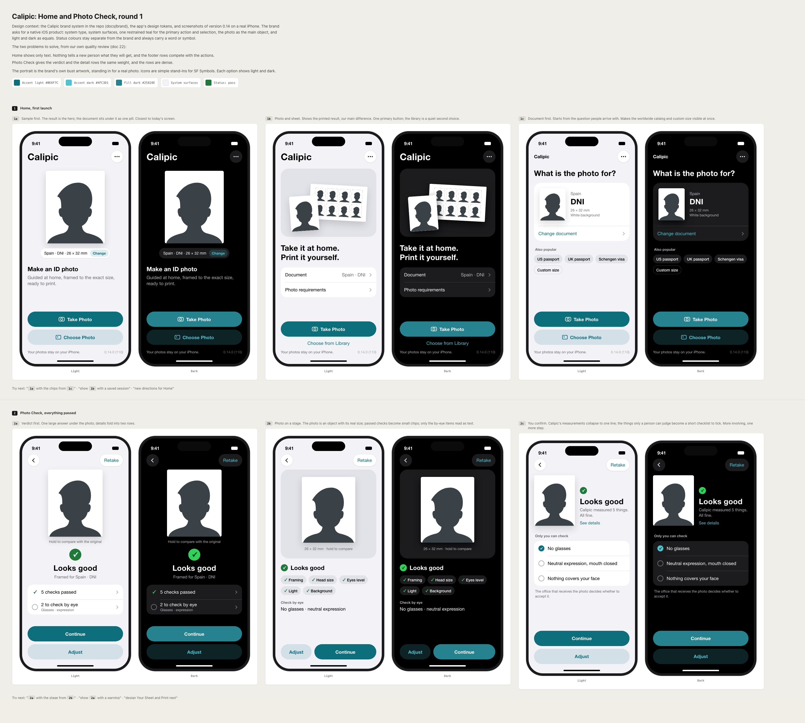
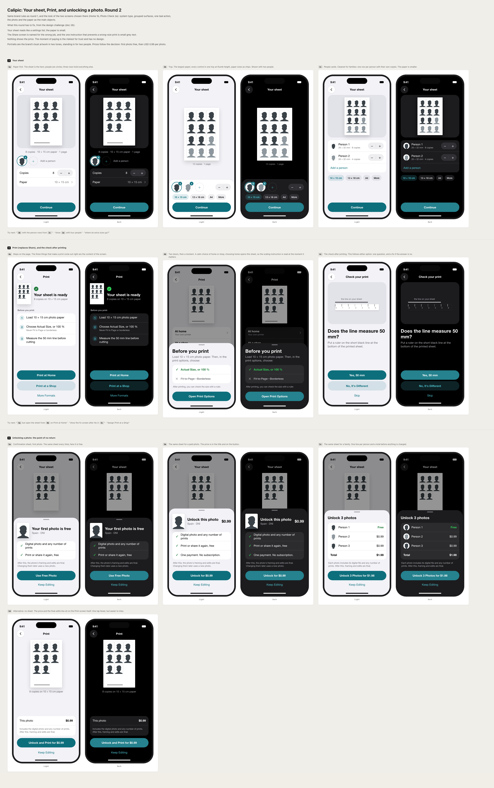

# Design explorations

Visual options made in Claude Design before building screens in SwiftUI. The repo stays the source of truth: every round is saved here as an image, and the chosen direction is recorded in this file.

**Project:** [Calipic — app screens](https://claude.ai/design/p/0a15a870-42c0-48fd-95e0-7f4553b302b0?file=Calipic+screens.dc.html). The standalone Claude Design server stops working by 14 December 2026 (Claude Design moves into Claude), so do not rely on the link surviving.

**Rules for every round:** follow [the visual identity](../../brand/07-visual-identity.md) and [design tokens](../../brand/11-design-tokens.md): system type and surfaces, one restrained teal, the photo as the main object, light and dark as equals, status with a word or symbol. Portraits are the brand's bust artwork, never real people.

## Round 1 — Home and Photo Check (2026-11-11)

Problems addressed, from [22 §3.3](../../22-quality-and-delight-bar.md): Home shows nothing photographic and its footer competes with the actions; Photo Check gives the verdict and the detail rows the same weight.

| ID | Screen | Direction |
|---|---|---|
| 1a | Home | Sample first: the result is the hero; the document is one pill under it |
| 1b | Home | Photo and sheet: shows the printed result; one primary button |
| 1c | Home | Document first: "What is the photo for?", popular documents and Custom size as chips |
| 2a | Photo Check | Verdict first: one large answer; details fold into two rows |
| 2b | Photo Check | Photo on a stage with its real size; passed checks as chips |
| 2c | Photo Check | You confirm: measurements collapse to one line; by-eye items become a checklist |

In all Home options, App Icon and the other settings move behind the top-right button (Settings & About, S-19), and the version stays on Home (AGENTS.md §17).

**Decision (founder, 2026-11-11):** Home **1b** and Photo Check **2a**. Built in spike 0.15.0; the contract is in [16 §3 and §8](../../16-screen-experience-spec.md). Related proposals that touch the same screens are in [26 — UX and design challenge](../../26-ux-design-challenge.md).

## Round 2 — Your sheet, Print, and unlocking a photo (2026-11-12)

File in the project: `Calipic screens round 2.dc.html`.

Problems addressed, from [26](../../26-ux-design-challenge.md):

- Your sheet reads like a settings list (A-table, doc 22 §3.3).
- Share is named for the wrong job, and the scaling instruction is small grey text (A1, A7).
- The price and the point of no return have no design (D6, ADR-048 §4).

| ID | Screen | Direction |
|---|---|---|
| 3a | Your sheet | Paper first: the sheet as hero, people as circles, two rows for copies and paper |
| 3b | Your sheet | Tray: the largest paper; people, copies, and paper chips in one tray at thumb height |
| 3c | Your sheet | People cards: one row per person with their own copies; smaller paper |
| 4a | Print | Steps on the page: load paper, Actual Size, measure the line; Print at Home, Print at a Shop, More Formats |
| 4b | Print | Two doors (At home, At a shop); choosing home opens a *Before you print* sheet with the scaling instruction |
| 4c | Check your print | The step after printing: "Does the line measure 50 mm?" with Yes, No, Skip |
| 5a | Unlock sheet | Confirmation sheet for the free first photo |
| 5b | Unlock sheet | The same sheet for one paid photo (USD 0.99) |
| 5c | Unlock sheet | The same sheet for a family: one line per person and a total |
| 5d | Unlock, alternative | No sheet: price and the final-edits line on the Print screen itself |

5a, 5b, and 5c are three states of one design; 5d is the alternative to it. 4c follows either 4a or 4b.

**Decision:** pending founder choice.
